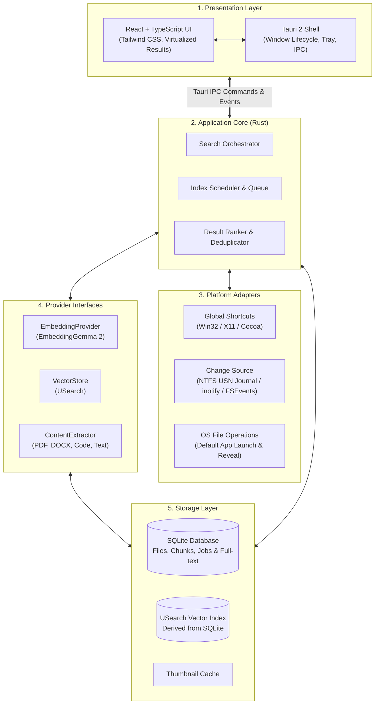

<div align="center">


# Search by Memory
### *Find what you remember, not what you named.*

[](LICENSE)
[](implementation/PRD.md)
[](implementation/PRD.md)
[](implementation/PRD.md)

<p align="center">
  <b>Instant semantic desktop search powered by local vector retrieval.</b><br>
  Search through your documents, code, notes, and media using vague recollections or natural descriptions.
</p>

```text
Alt + Space  ->  "That tutorial about attention mechanisms"  ->  Found in 32ms
```

---

</div>

## What is it?

We collect thousands of files across deep folders, but our brains remember **concepts**, **context**, or **snippets**—not filenames like `Report_final_v2_final.docx` or `screenshot_20261012.png`.

**Search by Memory** is a desktop launcher that bridges this gap using local semantic embeddings (**Google EmbeddingGemma 2** via ONNX Runtime) and vector similarity search (**USearch**), alongside instant filename and keyword search across your whole disk.

---

## Core Highlights

<table>
<tr>
<td width="50%">

### 100% Local and Private
* Zero cloud telemetry.
* No documents or queries leave your machine.
* Completely functional in air-gapped and offline environments.

</td>
<td width="50%">

### Instant Launcher (`Alt + Space`)
* Keyboard-first workflow (Arrow keys, `Enter`, `Ctrl+Enter`).
* Sub-second retrieval ($P95 < 1\text{s}$) across millions of chunks on a 1 TB+ disk.
* Minimal background memory and CPU footprint.

</td>
</tr>
<tr>
<td width="50%">

### Semantic-First Retrieval
* No generative LLM hallucinations or chat latency.
* Searches meaning, concepts, and synonyms—plus filenames and exact keywords, merged into one list.
* True source snippets and direct page or line references.

</td>
<td width="50%">

### Resilient Background Indexing
* Name search ready in minutes; content indexed newest-first in the background.
* Incremental change detection; moved and copied files are never re-embedded.
* Pauses automatically for full-screen apps, battery, and busy hardware.
* Choose any folder or drive, with sensible default exclusions pre-filled.

</td>
</tr>
</table>

---

## System Architecture

The project is structured around a clean 5-layer modular architecture to keep domain logic strictly decoupled from OS-specific integrations and UI rendering:



### Technology Breakdown

* **Desktop Shell**: Tauri 2 + React + TypeScript + Tailwind CSS for a featherlight desktop footprint.
* **Application Core**: Rust for deterministic concurrency, memory safety, and high-throughput job queueing.
* **Embedding Engine**: Google EmbeddingGemma 2 running in-process via ONNX Runtime in Rust (no Python shipped; Python is used only for offline dev tooling).
* **Storage and Index**: SQLite (with FTS5) for metadata, filename and keyword search & USearch for sub-second vector similarity retrieval.

---

## Roadmap and Supported Formats

| Phase | Modality | Supported Formats |
| :--- | :--- | :--- |
| **P0 (MVP)** | **Names, Documents and Code** | Filename search for every file; content search (semantic + keyword) for `.pdf`, `.docx`, `.txt`, `.md`, source code (`.rs`, `.py`, `.ts`, `.go`, etc.) |
| **P1** | **Visual and Screenshots**| Image embeddings, OCR for screenshots, thumbnail preview cards |
| **P2** | **Audio and Video** | Audio transcription via local Whisper, FFmpeg soundtrack extraction, timestamp jumping |
| **P3** | **Advanced Retrieval** | Cross-modal blending, non-generative reranking, local query history |

---

## Documentation

For complete technical specifications, architectural diagrams, acceptance criteria, and benchmarks, check the full PRD:

[Read the Full Product Requirements Document (PRD.md)](implementation/PRD.md)

* [Domain glossary (CONTEXT.md)](CONTEXT.md) — the shared vocabulary used across docs and code.
* [Architecture Decision Records (docs/adr/)](docs/adr/) — why we chose ONNX Runtime, USearch, two indexes, and content-keyed chunks.

---

## License

This project is licensed under the [MIT License](LICENSE).


