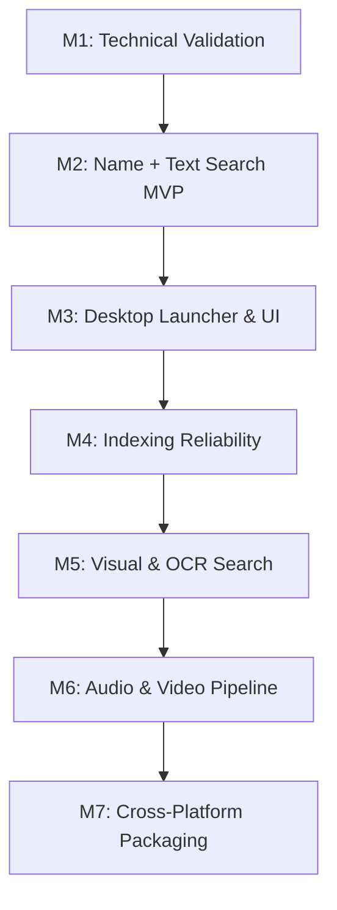

# Product Requirements Document (PRD)

# Search by Memory

**Version:** 2.1  
**Date:** October 12, 2026  
**Status:** Approved / Technical Design Specification  
**Primary Target Platform:** Windows 10/11 (64-bit)  
**Long-term Target Platforms:** Linux, macOS (Cross-platform Core Architecture)  

> Domain terms in this document (e.g., **Chunk**, **Name Index**, **Content Match**, **Copy**) are defined in [`CONTEXT.md`](../CONTEXT.md). Architectural decisions are recorded in [`docs/adr/`](adr/).

---

## Product Vision

> *"Find what you remember, not what you named."*

---

## 1. Product Overview

**Search by Memory** is a fast, local-first desktop search application that empowers users to find local files using natural language descriptions and semantic similarity. Users are freed from remembering exact filenames, nested directory paths, or strict keywords. Instead, they can query using vague recollections, conceptual descriptions, or partial context about the file's content — while still finding files instantly by name, like Windows Search.

### Representative User Queries:
* *"The document explaining RAG architecture and retrieval evaluation metrics."*
* *"Screenshot of the database connection error diagram I saved a while ago."*
* *"Auth service code implementation that handles JWT refresh tokens."*
* *"Video tutorial explaining attention mechanisms: query, key, and value."*
* *"PDF research paper about embedding models that I read a few months ago."*
* `docker-compose` or `invoice march` — exact or partial filenames.

The application is designed to cover an entire disk (1 TB+). It maintains two indexes (see [ADR 0003](adr/0003-name-index-and-content-index.md)):
* a **Name Index** of every file beneath the user's Indexed Folders, searchable by filename and path within minutes of setup; and
* a **Content Index** of Chunks from supported formats, searchable by meaning (embeddings generated locally with **Google EmbeddingGemma 2**) and by keyword.

Built as an instant, keyboard-first desktop launcher (accessible via a global shortcut), it provides verbatim snippets, page/line references, and one-keystroke actions to open files or reveal their locations in the system file manager.

### Core Product Principles:
1. **Local-first & Privacy by Default**: No documents, embeddings, or queries leave the user's device. Complete offline capability after initial setup.
2. **Semantic-first, Name-aware**: Retrieval is powered by content meaning and context, complemented by exact filename and keyword matching.
3. **Fast by Design**: Indexing runs asynchronously in the background so queries execute near-instantaneously against pre-computed indices.
4. **Cross-platform by Architecture**: The application core, database schemas, and data pipelines are strictly decoupled from OS-specific APIs.
5. **Extensible & Modular**: Extractor backends, embedding models, vector stores, and modality pipelines adhere to clean provider contracts.
6. **No Generative LLM Required**: Core search does not rely on generative LLMs or chatbot summaries, avoiding hallucinations, unpredictable latency, and excessive resource consumption.

---

## 2. Problem Statement & User Pain Points

Users accumulate hundreds of thousands of heterogeneous files (documents, source code, screenshots, diagrams, audio recordings, video lectures) scattered across drives and complex folder trees.

Conventional file search tools (like Windows Search or standard file managers) suffer from key limitations:
1. **Name & Path Dependency**: Users frequently forget exact filenames or storage paths.
2. **Vocabulary Mismatch**: The keywords remembered by the user differ from the exact wording inside the file.
3. **Multimodal Blindness**: Image screenshots, diagrams, video segments, and audio files cannot be discovered by content without semantic feature extraction.
4. **Search Friction**: Digging through folder trees or waiting for unindexed disk scans disrupts user workflow.
5. **Stale Indices**: Outdated or inconsistent indices lead to missing files or broken references.

### Target User Personas:

| Persona | Primary Needs & Use Cases |
| :--- | :--- |
| **Software Engineers** | Finding past implementations, configuration snippets, architectural notes, and test suites across legacy repositories. |
| **Researchers & Students** | Locating academic papers, lecture notes, textbook chapters, and recorded seminar timestamps. |
| **Knowledge Workers** | Retrieving meeting decks, slide screenshots, project reports, and client notes across disconnected folders. |
| **Digital Archivists** | Navigating and exploring expansive local file archives containing mixed media. |

---

## 3. Product Goals and Non-Goals

### 3.1 Primary Goals
* Enable file retrieval via natural language descriptions, semantic similarity, filenames, and keywords.
* Deliver sub-second query latency across an entire 1 TB+ disk.
* Operate fully offline without cloud dependencies or telemetry transmitting user data.
* Provide a keyboard-driven desktop launcher experience (low latency, minimal workflow disruption).
* Support incremental, background indexing with resilient recovery, pause/resume, and checkpointing, without disrupting games, calls, or battery life.
* Architect a clean abstraction layer enabling expansion from documents and code to images, OCR, audio, and video across Windows, Linux, and macOS.

### 3.2 Non-Goals
* **No Generative Chatbot**: The app will not act as a conversational assistant or generate multi-document synthesis text.
* **No File Mutation**: The app will not edit, move, organize, or delete user files automatically.
* **No Cloud Downloads**: The app never causes Online-only Files to be downloaded in order to index them.
* **No OS Search Replacement**: Not intended to hijack system shortcuts (such as the standalone Windows key) or replace low-level OS utilities.
* **No Cloud Sync/Backup**: No syncing of index data or files to third-party cloud infrastructure.
* **No Universal Content Ingestion on Day 1**: Every in-scope file is findable by name, but only formats with a dedicated, validated extractor are indexed by content.

---

## 4. System Architecture & Tech Stack

Following the **Modular 5-Layer Architecture**, the core business logic remains independent of the presentation and operating system layers.

```
┌────────────────────────────────────────────────────────┐
│                   Presentation Layer                   │
│         React + TypeScript + Tailwind (UI Shell)       │
└───────────────────────────▲────────────────────────────┘
                            │ Tauri IPC / Events
┌───────────────────────────▼────────────────────────────┐
│                    Application Core                    │
│   Rust (Query Orchestration, Rank Fusion, Index        │
│   Scheduler, Throttling, In-process ONNX Embedding)    │
└───────────────┬────────────────────────▲───────────────┘
                │                        │
┌───────────────▼──────────────┐ ┌───────┴───────────────┐
│      Platform Adapters       │ │  Provider Interfaces  │
│  - Global Shortcuts          │ │  - EmbeddingProvider  │
│  - Change Source (USN/watch) │ │  - VectorStore        │
│  - File Launch & Reveal      │ │  - ContentExtractor   │
│  - Power/Activity Monitor    │ │  - MediaProcessor     │
│  - Volume & Cloud-file Info  │ │                       │
└──────────────────────────────┘ └───────┬───────────────┘
                                         │
┌────────────────────────────────────────▼───────────────┐
│                     Storage Layer                      │
│  SQLite (Files, Content, Chunks, Jobs, Full-text)      │
│  USearch (Vector Index, derived from SQLite)           │
│  Local Preview/Thumbnail Cache                         │
└────────────────────────────────────────────────────────┘
```

### 4.1 Component Stack

| Component | Initial Technology | Responsibility |
| :--- | :--- | :--- |
| **Desktop Shell** | **Tauri 2** | Window lifecycle, desktop system tray, secure IPC, native packaging. |
| **Frontend UI** | **React + TypeScript** | Launcher UI, keyboard navigation, File view with Preview Pane, settings, indexing dashboard. |
| **Application Core** | **Rust** | Search orchestration, rank fusion, file scheduling, throttling, SQLite interaction, memory bounds. |
| **Embedding Runtime** | **ONNX Runtime (`ort`) in Rust + EmbeddingGemma 2** | In-process embedding of Queries and Chunks; GPU via CUDA/DirectML execution providers with CPU fallback. No Python ships with the app ([ADR 0001](adr/0001-onnx-runtime-in-rust-python-as-dev-tooling-only.md)). |
| **Dev Tooling** | **Python** (offline only) | Benchmark runner, embedding-dimension experiments, ONNX-vs-PyTorch parity checks. |
| **Vector Index** | **USearch** (via `VectorStore` interface) | Approximate nearest-neighbour search over Chunk embeddings; memory-mapped, `f16`/`i8` storage ([ADR 0002](adr/0002-usearch-instead-of-faiss.md)). |
| **Relational Metadata & Keyword Search** | **SQLite + FTS5** | File tracking, content hashes, Chunks, jobs, exclusions, configuration; full-text search for the Name Index and Chunk keywords. |
| **File Extraction** | Modular Extractors (native Rust) | Extraction of raw text from PDF, DOCX, Markdown, plain text, and source code. |
| **OCR & Vision** | Tesseract / Local Vision Pipeline | Extracting text from screenshots and image embeddings (P1). |
| **Audio/Video** | Local Whisper & FFmpeg | Audio transcription and keyframe extraction (P2). |

### 4.2 Architectural Layers
1. **Presentation Layer**: Thin, reactive UI handling user input, keyboard events, virtualized result rendering, and indexing telemetry.
2. **Application Core**: Pure domain logic orchestrating retrieval and rank fusion, chunking pipelines, job queues, prioritization, and throttling.
3. **Platform Adapters**: OS-specific implementations for global hotkeys, change detection (NTFS USN Journal preferred on Windows; `ReadDirectoryChangesW` / `inotify` / `FSEvents` plus reconciliation scans elsewhere), volume identity, cloud-file (online-only) detection, power/full-screen/activity detection, and default file opening.
4. **Provider Interfaces**: Decoupled trait/interface boundaries for `EmbeddingProvider`, `VectorStore`, `ContentExtractor`, and `ChangeSource`.
5. **Storage Layer**: SQLite transactional database (source of truth) alongside the derived USearch index file and on-disk thumbnail caches.

---

## 5. Scope & Phased Implementation

### P0 — Minimum Viable Product (Name + Semantic Text Search)
* **Desktop Launcher Window**: Centered, distraction-free search bar summonable via configurable global shortcut.
* **Indexed Folders**: The user chooses any folders or whole drives to index (e.g., `D:\my-memories\` or `D:\`). Everything beneath them is indexed except Exclusions.
* **Default Exclusions**: Pre-filled, user-editable Exclusions so users need not type common ones (see FR-03).
* **Name Index**: Every file beneath the Indexed Folders, of any format, searchable by filename and path; built before any content indexing.
* **Content Index**: Full content extraction and indexing for:
  * PDF (`.pdf`)
  * Word Documents (`.docx`)
  * Plain Text (`.txt`)
  * Markdown (`.md`, `.markdown`)
  * Source Code (`.rs`, `.py`, `.js`, `.ts`, `.go`, `.cpp`, `.c`, `.java`, `.json`, `.yaml`, `.toml`, etc.)
* **Hybrid Retrieval**: Semantic (vector) and keyword (FTS5) search over Chunks, plus Name Index search, merged into one ranked list.
* **Embedding Model**: Google EmbeddingGemma 2 running locally via ONNX Runtime.
* **Vector Store**: USearch with persistent on-disk index, rebuildable from SQLite.
* **Metadata & State Storage**: SQLite handling file catalog, content hashes, Chunks, and index statuses.
* **Result Presentation**: File view, grouped by kind of file, with a Preview Pane for the selected Result; filename, formatted path, Snippet with the Query's words marked, page/line reference, Match Reason, and file icon. Weaker Matches are collapsed.
* **Direct Actions**: Open with default application, reveal in system file explorer, copy the file.
* **Background Incremental Indexing**: Newest-first Initial Indexing, prioritized Live Updates, and content-hash reuse for moved, renamed, and copied files.
* **Crash Recovery & Resume**: Resumption of interrupted indexing jobs upon restart.
* **Automatic Throttling**: Indexing pauses for full-screen apps, battery power, and busy CPU/GPU.
* **100% Offline Capability**: Runs entirely disconnected once the installer and model weights are present.

### P1 — Visual & Screenshot Search
* **Text-to-Image Search**: Finding images/diagrams via natural language descriptions matching image embeddings.
* **Local OCR Pipeline**: OCR processing for screenshots, infographics, and scanned PDFs (Tesseract or optimized local OCR) stored as searchable Chunks.
* **Image Thumbnails**: High-performance local thumbnail caching and rendering in the launcher.
* **Metadata Filters**: Quick filtering by file type, parent folder, file size, and modification date.
* **Incremental Visual Indexing**: Efficient diffing of image modifications and deletions.

### P2 — Audio & Video Semantic Search
* **Local Audio Transcription**: Audio segment transcription via local Whisper models.
* **Video Audio Extraction**: Automated audio track extraction from common video containers (`.mp4`, `.mkv`, `.mov`) via FFmpeg.
* **Timestamp Jumping**: Search results link directly to exact media timestamps and launch in media players supporting timestamp parameters.
* **Keyframe Visual Indexing**: Sampling video keyframes for visual scene retrieval.
* **Strict Resource Throttling**: Media indexing follows the same throttling rules, with stricter idle requirements.

### P3 — Advanced Retrieval & Refinement
* **Cross-Modal Result Blending**: Balanced ranking between text, OCR, image, and transcript matches.
* **Non-Generative Reranking**: Lightweight cross-encoder reranking on top of the P0 rank fusion, without generative LLM overhead.
* **Local Query History**: Optional, privacy-preserving recent query suggestions with one-click clear.
* **Hardware-Specific Optimizations**: Auto-selection between CPU AVX-512, CUDA, DirectML, and Apple Silicon acceleration.

---

## 6. Functional Requirements (FR) & Acceptance Criteria

### FR-01: Search Launcher & UX
* **Description**: A lightweight, overlay search window accessible globally from any active application.
* **Specifications**:
  * Default shortcut: `Ctrl + Shift + Space` (configurable; conflict detection enabled; must not hijack standalone Windows key).
    * `Alt + Space` is avoided: on Windows it opens the active window's system menu and is the default PowerToys Run shortcut. If registration fails or a conflict is detected, the app must notify the user and prompt for an alternative (suggested fallback: `Ctrl + Alt + Space`) rather than fail silently.
    * Onboarding tests the shortcut live: it says when the keys were pressed and caught.
  * Opens within $\le 300\text{ ms}$ from warm background state.
  * Auto-focuses query input immediately upon opening.
  * Navigable entirely via keyboard:
    * `Arrow Up` / `Arrow Down`: Move selection through Results (and through the Copies being chosen from).
    * The Preview Pane always shows the selected Result (layout after DigUp, decided 2026-10-14).
    * `Enter`: Open the selected file with the system default handler. If the Result has several Copies, the Preview Pane asks which Copy to open (`Arrow Right` starts choosing, `Arrow Left` stops), starting on the Copy picked most recently.
    * `Ctrl + Enter` (or `Shift + Enter`): Reveal enclosing folder in File Explorer (asks which Copy when there are several).
    * `Ctrl + C`: Copy the file itself to the clipboard, to paste anywhere (asks which Copy when there are several).
    * `Escape`: Dismiss launcher window without interrupting background indexing.
  * Opening a specific page uses the Copy the user last chose for that file, or the first listed Copy.
  * Filter Prefixes may be typed anywhere in the Query and combined: `ext:` (several = any), `in:` (a folder name contains it; never the drive), `date:` (`today`, `yesterday`, `week`, `month`, `year`, `2025`, `2025-03`; by modified time), `code:`, `name:` (names only). Each shows as a chip in the Query bar. Filters with no Query words list the newest files that pass them (decided 2026-10-16).
  * When only a Result's name is searched, the Preview Pane says why: the file is online only (download it to search inside), its format is not read, it is not read yet, or it could not be read (with the plain-language reason from FR-08).
* **Acceptance Criteria**:
  * [ ] Launcher appears instantly on global hotkey trigger.
  * [ ] Selecting a result opens the target file in the correct default application.
  * [ ] Enclosing folder can be revealed in File Explorer without launching the file.
  * [ ] Results with several Copies never open an arbitrary Copy without the user choosing.
  * [ ] Dismissing the launcher retains background indexing processes seamlessly.

### FR-02: Query Encoding, Retrieval & Ranking
* **Description**: Runs each Query against the Name Index and the Content Index (semantic and keyword) and merges the results into one ranked list.
* **Specifications**:
  * Supports multilingual queries (tested primarily for English and Indonesian).
  * Adheres strictly to the official EmbeddingGemma 2 prompt/task formatting guidelines.
  * Semantic search executed via the `VectorStore` abstraction (backed by USearch); keyword and name search via SQLite FTS5.
  * The three ranked lists are merged with rank fusion (e.g., Reciprocal Rank Fusion): a file ranking well in several lists rises above files ranking well in only one.
  * An exact filename match is always placed at the top.
  * **File view** (default): one Result per file (grouping its Copies), ranked by its single best Content Match or its Name Match; returns configurable top-$K$ (default: 20).
  * **Passage view** (index API and Benchmark only, not in the launcher): one Result per Content Match; files found only by name do not appear.
  * **Weaker Matches**: Results far below the best ones are collapsed under a "weaker matches" group instead of being listed with them.
  * Every Result shows a truthful **Match Reason**: `name`, `content`, or both.
  * Raw similarity scores are used as ranking indicators, not as probability truth values.
* **Acceptance Criteria**:
  * [ ] User query generates an embedding locally without network activity.
  * [ ] Retrieval returns relevant candidates across varied terminology (synonyms, conceptual descriptions).
  * [ ] Exact and partial filename queries (e.g., `docker-compose`) return the named file at or near the top.
  * [ ] In File view, multiple Content Matches from the same file never flood the result list.

### FR-03: Indexed Folders, Exclusions & Content Extraction
* **Description**: Determines which files are indexed, parses supported content, and splits long documents into coherent Chunks.
* **Specifications**:
  * The user selects Indexed Folders (any folder or whole drive). Everything beneath them, including hidden files, enters the Name Index unless excluded.
  * Onboarding asks for **one** location, the way an installer asks where to install: the personal folder is pre-filled, *Change…* opens the system folder picker, *Reset to default* returns to the personal folder, and the location shows an estimate (files and size, Default Exclusions applied). More Indexed Folders are added in Settings.
  * **Default Exclusions** (pre-filled, removable, extendable by the user):
    * On the system drive only: `Windows`, `Program Files`, `Program Files (x86)`, `ProgramData`, `$Recycle.Bin`, `System Volume Information`, `Users\*\AppData`, `Users\Default`, `Users\Public`. Personal folders under `C:\Users\<name>\` (Documents, Desktop, Downloads, Pictures, source, etc.) remain indexed.
    * Anywhere on any drive: `node_modules`, `.git`, `target`, `venv`, `.venv`, `__pycache__`, `.cache`, `$RECYCLE.BIN`.
  * The Content Index additionally requires a supported format and a size threshold (e.g., skip text files $>50\text{ MB}$).
  * **Online-only Files** (OneDrive, Google Drive, Dropbox placeholders) enter the Name Index but are never opened for content; once the user downloads one, it is content-indexed automatically.
  * Initial parser support for `.pdf`, `.docx`, `.txt`, `.md`, and programming language sources.
  * Chunking strategy: Dynamic sliding window (e.g., 256–512 tokens with 10–20% overlap) retaining page/line Locations.
  * Robust error handling: Unreadable, encrypted, or corrupted files must be logged and bypassed without halting indexing.
  * Ignores temporary lock files (`~$*.docx`) for content.
* **Acceptance Criteria**:
  * [ ] Parsing failure on an encrypted or corrupt document logs an error and continues with the queue.
  * [ ] Original user files are strictly treated as read-only and never modified.
  * [ ] Online-only Files are never downloaded as a side effect of indexing.
  * [ ] Extracted Chunks retain accurate page numbers or line ranges for result previews.

### FR-04: Incremental Indexing, Prioritization & Job Resiliency
* **Description**: Builds and continuously maintains both indexes efficiently and without disrupting the user.
* **Specifications**:
  * **Initial Indexing order**: the Name Index for all Indexed Folders is built first; the Content Index is then filled from the most recently modified files to the oldest.
  * **Live Updates**: files created or changed after Initial Indexing began are processed ahead of remaining Initial Indexing work.
  * Change detection via a platform `ChangeSource`: the NTFS USN Journal on Windows (catches changes made while the app was not running), falling back to filesystem watchers paired with periodic reconciliation scans.
  * File tracking uses path, size, and modification timestamp (`mtime`) as a cheap first-pass filter. When size or `mtime` differ, a full-content fast hash (e.g., BLAKE3/xxHash) confirms whether content actually changed. Header-only hashing is not sufficient.
  * **Content reuse**: Chunks and embeddings are keyed by content hash ([ADR 0004](adr/0004-content-addressed-chunks.md)). A moved, renamed, or copied file with a known hash reuses existing Chunks without re-embedding.
  * Atomic index updates: Changed content gets new Chunks and vectors; obsolete vectors are removed from USearch when no file references their content any longer.
  * Job queue checkpoints progress so interrupted indexing resumes from the last completed file.
  * **Throttling**: Initial Indexing pauses while a full-screen application is running, while on battery power, or while CPU/GPU are busy with other work, and resumes after a quiet period. Live Updates continue on CPU in all of these cases. The tray menu offers manual pause (e.g., 1 hour / until tomorrow).
  * **Disconnected Drives**: Files on an unavailable USB, external, or network drive stay in both indexes, flagged as not connected. When the drive returns, only changes are re-checked. Drives are identified by volume ID, not drive letter.
* **Acceptance Criteria**:
  * [ ] Name search works within minutes of adding Indexed Folders, before content indexing completes.
  * [ ] Recently modified files become content-searchable before older files.
  * [ ] Modifying a file updates its index entries without a full directory re-index.
  * [ ] Moving or renaming a folder of already-indexed files triggers no re-embedding.
  * [ ] Deleted files are purged from search results immediately or upon next reconciliation.
  * [ ] Reconnecting a drive under a different drive letter does not cause re-indexing.
  * [ ] Indexing does not run on the GPU while a full-screen application is active.
  * [ ] Sudden app shutdown or crash does not corrupt SQLite or the vector index; pending jobs resume on next startup.

### FR-05: Storage, Reconciliation & Migrations
* **Description**: Coordinates transactional relational metadata with the derived vector index.
* **Specifications**:
  * **SQLite Database** (source of truth):
    * `files` (id, volume_id, path, size, mtime, content_hash, is_online_only, status, error_message) — one row per file on disk.
    * `contents` (content_hash, format, extracted_at, status) — one row per distinct file content, shared by Copies.
    * `chunks` (id, content_hash, chunk_index, page_number, line_start, line_end, text_snippet, embedding, vector_id).
    * `index_jobs` (id, file_id, job_type, priority, status, retry_count, created_at).
    * FTS5 virtual tables over file names/paths and Chunk text.
    * Schema versioning managed via automated database migrations.
  * **Vector Store**:
    * USearch index keyed by `vector_id`, mapped bidirectionally to Chunks.
    * Vectors are removed by key when their content is no longer referenced by any file.
    * Periodic compaction and serialization to disk; the index file can be memory-mapped to keep idle RAM low.
    * Self-healing reconciliation: If the vector index and SQLite fall out of sync, SQLite serves as the source of truth for rebuilding the vector index.
* **Acceptance Criteria**:
  * [ ] SQLite schema migrations apply automatically across application upgrades.
  * [ ] Database and vector store remain consistent across insertions and deletions.
  * [ ] Rebuilding the vector index is possible from stored Chunk embeddings without reparsing or re-embedding source files.

### FR-06: Privacy, Offline Integrity & Exclusions
* **Description**: Guarantees zero external data leakage and provides full exclusion controls to the user.
* **Specifications**:
  * Zero remote telemetry containing file names, paths, queries, or extracted content.
  * Exclusions: Folders (glob patterns), file extensions, and file size thresholds, pre-filled with Default Exclusions.
  * "Clear All Data" action: One-click option to completely purge local SQLite databases, vector indices, and cached thumbnails.
* **Acceptance Criteria**:
  * [ ] Application functions completely in an air-gapped environment with network adapters disabled.
  * [ ] Excluded directories and file patterns are never opened, parsed, or embedded.
  * [ ] Purge action thoroughly erases all index artifacts from disk.

### FR-07: Cross-Platform Abstraction
* **Description**: Application core and data models remain platform-agnostic, with all OS-specific facilities delegated to platform adapters.
* **Specifications**:
  * Files are identified internally by volume ID plus a normalized relative path (forward-slash UTF-8), so drive-letter changes do not alter identity.
  * Adapters implement distinct implementations for Windows (`windows-sys`/Win32, USN Journal), Linux (`X11`/`Wayland`, `inotify`), and macOS (`Cocoa`, `FSEvents`).
* **Acceptance Criteria**:
  * [ ] Core Rust logic compiles and executes unit tests on Windows, Linux, and macOS environments without OS-specific `#cfg` branches in business logic.

### FR-08: Observability & Status Dashboard
* **Description**: Transparent status reporting for background indexing activities and resource utilization.
* **Specifications**:
  * Dashboard displays: files in the Name Index, Content Index progress, pending jobs, failed files, index size on disk, and model status.
  * Initial Indexing progress states how far back content search reaches (e.g., *"Content index 34% — files since March 2025 are ready"*).
  * When indexing is paused, the dashboard and tray state why (full-screen app, battery, busy system, or manual pause).
  * Initial Indexing is visible from the start: right after the location is chosen, onboarding shows an Indexing step with the name pass (files found so far), then the content pass (files read of total, speed, time left, the file being read, failures) and the model's state (downloading, loading, ready, or failed with *Try again*). *Start searching* is available once names are searchable; the same progress stays in the dashboard.
  * The model download starts right after the speed choice and shows its progress; the user may continue onboarding while it runs, and the tray shows it until it ends.
  * Search results report retrieval latency (e.g., *"Found 12 matches in 42 ms"*).
  * Actionable error log allowing users to review why specific files failed extraction (e.g., password-protected PDF).

---

## 7. Non-Functional Requirements & Engineering Baselines

### 7.1 Performance Benchmarks
* **Launcher Render Time**: $\le 300\text{ ms}$ (warm process in system tray).
* **Search Query Latency**: $P95 \le 1.0\text{ second}$ for queries on an index of 2,000,000 Chunks.
* **Name Index Availability**: Name search usable within minutes of adding a 1 TB drive.
* **Idle System Footprint**: $\le 1\text{–}2\%\text{ CPU}$ usage and minimal RAM when no active indexing is occurring.
* **Indexing Throughput**: Background extraction and embedding throttled per FR-04 to prevent UI stutter, game stutter, or battery drain.

### 7.2 Hardware Baseline & Storage Planning
* **Development Target Baseline**:
  * OS: Windows 10/11 64-bit
  * CPU: 6-core / 12-thread modern x86_64 CPU
  * RAM: 16 GB DDR4/DDR5
  * GPU: NVIDIA GeForce RTX 4060 (8 GB VRAM) for accelerated inference, with CPU fallback.
* **Scale Assumption**: A full 1 TB Windows disk typically holds 0.5–2 million files; content-indexable documents and code may yield 1–2 million Chunks.
* **Vector Storage Footprint Estimation** (EmbeddingGemma 2 at 256 dimensions):
  * `f32`: $256 \times 4 = 1{,}024$ bytes per vector; `f16`: 512 bytes; `i8`: 256 bytes.
  * **500,000 Chunks**: $\approx 128$–$512\text{ MB}$ of vectors depending on precision.
  * **2,000,000 Chunks**: $\approx 0.5$–$2\text{ GB}$ of vectors depending on precision (`f16`/`i8` targeted: $\approx 0.5$–$1\text{ GB}$), plus SQLite metadata and full-text tables.
* **Initial Indexing Duration** (to be measured in Milestone 1): expected to take hours on GPU and potentially a day or more on CPU for a full disk, which is why indexing is newest-first and name search is available first.

---

## 8. UX & Keyboard-First Interaction Design

The launcher is a frameless floating panel in the style of DigUp (github.com/ARahim3/DigUp; layout and behaviour only, with its own colours): Results on the left, a Preview Pane on the right, status and key hints at the bottom.

### UI Layout
```
┌──────────────────────────────────────────────────────────────┐
│ ⌕  net profit went up after the launch                       │
├────────────────────────────┬─────────────────────────────────┤
│ Documents                  │  ┌───────────────────────────┐  │
│ ▌Q3 Report.docx   Page 14  │  │ …net profit increased by  │  │
│    …net profit increased…  │  │ 18% following the launch… │  │
│  slides.pdf       Page 4   │  └───────────────────────────┘  │
│    …key and value vectors… │  Q3 Report.docx                 │
│ Code                       │  D:\Work\Finances\2026          │
│  auth_service.rs  Line 142 │  Word document, 2.1 MB,         │
│    pub async fn refresh…   │  changed 3 October 2026         │
│ › 5 weaker matches         │  Name and contents match        │
│                            │  [Open]  [Show in folder]       │
│                            │  Copies: 2 more places          │
├────────────────────────────┴─────────────────────────────────┤
│ 3 results, 5 weaker      ↵ Open  Ctrl+↵ Show  Ctrl+C Copy    │
└──────────────────────────────────────────────────────────────┘
```

### UX Design Rules:
1. **Zero Layout Shifts**: Results render in stable slots with virtual scrolling.
2. **True Explanations Only**: Snippets are verbatim extracts from the Chunk or metadata, and Match Reasons state truthfully why a Result was returned; the system never invents justifications.
3. **Missing File Indication**: If a file was deleted externally while still in the index, the Result is flagged as *"File missing from disk"* and offers an option to purge it.
4. **Disconnected Drive Indication**: Results on an unavailable drive are flagged (e.g., *"On drive E: (not connected)"*) rather than hidden.

---

## 9. Evaluation Plan & Quality Metrics

Retrieval quality is the primary product metric. A **Benchmark** of **50–100 Queries** (spanning English and Indonesian) is maintained. Each Query is labelled with a **Target**: the correct file plus the **Location** (page number or line range) of the remembered content. Targets never reference Chunk IDs, so labels survive changes to chunking.

Benchmarks run against two corpora:
* **Public Corpus**: a shared, reproducible file collection (e.g., open-access papers, open-source repositories, Indonesian documents) fetched by script, used for regression testing in CI.
* **Personal Corpus**: the developer's own files, used for private reality checks; results are never shared.

### Evaluation Metrics:
* **Recall@5 & Recall@10** (File view): Proportion of Queries whose Target file appears in the top 5 / 10 Results.
* **Mean Reciprocal Rank (MRR)** (File view): Ranking position of the Target file.
* **nDCG@10** (File view): Multi-candidate ranking quality.
* **Location Accuracy**: How often the Snippet shown for a correctly found file overlaps the Target's Location.
* **P50 & P95 Search Latency**: Query responsiveness.
* **Extraction Failure Rate**: Percentage of encountered files that fail ingestion.

### Comparison Baselines:
1. Filename match only (Name Index alone).
2. Keyword (FTS5/BM25) search only.
3. Semantic search only, across embedding dimensions (e.g., 256 vs 512 vs 768) and precisions (`f32` vs `f16` vs `i8`).
4. USearch approximate results vs exact (exhaustive) search, to measure recall loss from the index.

---

## 10. Phased Implementation Milestones



* **Milestone 1 — Technical Validation**:
  * Confirm the exact EmbeddingGemma model variant/version, license, supported output dimensions, and official prompt/task format.
  * **ONNX parity gate** ([ADR 0001](adr/0001-onnx-runtime-in-rust-python-as-dev-tooling-only.md)): ONNX Runtime embeddings in Rust must match the PyTorch reference (cosine ≥ ~0.99 on Benchmark inputs), with tokenization and prompt formatting reproduced in Rust.
  * Benchmark embedding throughput on CPU vs GPU (CUDA/DirectML) and estimate full-disk Initial Indexing time.
  * Validate USearch insertion, removal by key, search, memory-mapped loading, and `f16`/`i8` recall vs exact search.
  * Assemble the Public Corpus and first Benchmark labels.
* **Milestone 2 — Name + Text Search MVP**:
  * Implement the Name Index (FTS5) and volume-aware file catalog.
  * Implement extractors for PDF, DOCX, TXT, Markdown, and code.
  * Implement sliding-window chunking, content-hash keyed Chunks, and keyword + semantic retrieval with rank fusion.
  * End-to-end command-line retrieval verification against the Benchmark.
* **Milestone 3 — Desktop Launcher UI**:
  * Build Tauri 2 + React + TypeScript launcher with File view and Preview Pane.
  * Implement global hotkey registration with conflict handling, keyboard navigation, and file launch actions.
* **Milestone 4 — Indexing Reliability & Monitoring**:
  * Implement USN Journal change source, newest-first prioritization, and Live Updates.
  * Implement throttling (full-screen, battery, busy system), job pause/resume, and checkpoint recovery.
  * Implement Disconnected Drive handling and Online-only File detection.
  * Indexed Folders and Exclusions settings, and status dashboard.
* **Milestone 5 — Visual Search (P1)**:
  * Local OCR integration for screenshots and scanned PDFs, and image embedding pipeline.
  * Image thumbnail generation and launcher preview cards.
* **Milestone 6 — Audio & Video Search (P2)**:
  * Local Whisper integration for audio and extracted video soundtracks.
  * Timestamp jumping support.
* **Milestone 7 — Cross-Platform Expansion**:
  * Implement Linux and macOS platform adapters.
  * Validate packaging across `.msi`/`.exe`, `.AppImage`/`.deb`, and `.dmg`.

---

## 11. Technical Decisions

### 11.1 Resolved
1. **Embedding runtime**: ONNX Runtime in Rust; no Python in the shipped app — [ADR 0001](adr/0001-onnx-runtime-in-rust-python-as-dev-tooling-only.md). (Eliminates the former Rust ↔ Python IPC decision.)
2. **Vector index**: USearch instead of FAISS — [ADR 0002](adr/0002-usearch-instead-of-faiss.md).
3. **Index structure**: separate Name Index and Content Index, with keyword search in the MVP — [ADR 0003](adr/0003-name-index-and-content-index.md).
4. **Chunk identity**: Chunks and embeddings keyed by content hash — [ADR 0004](adr/0004-content-addressed-chunks.md).
5. **Throttling**: automatic pause for full-screen apps, battery, and busy CPU/GPU; Live Updates exempt (FR-04).

### 11.2 Open (to be resolved by Milestone 1 measurements)
1. **Default Embedding Dimension**: Whether 256-dimension truncation preserves sufficient semantic fidelity compared to 512/768.
2. **Vector Precision**: `f16` vs `i8` storage in USearch, based on Benchmark recall.
3. **Rank Fusion Tuning**: Fusion constant and relative weighting of name, keyword, and semantic lists.
4. **Index Encryption at Rest**: Whether Snippets and Chunk text stored in SQLite should be encrypted, given they contain private file content.
5. **Throttling Thresholds**: Exact CPU/GPU busy thresholds and quiet-period durations.

---

## 12. Definition of Done (DoD) for MVP

The MVP release is considered complete and production-ready when:
* [ ] Application installs and launches cleanly on Windows 10/11 (64-bit) as a single installer with no Python runtime.
* [ ] User can choose Indexed Folders and edit pre-filled Default Exclusions in settings.
* [ ] Every file beneath the Indexed Folders is findable by name shortly after setup.
* [ ] Core document formats (PDF, DOCX, TXT, MD, source code) are reliably parsed and embedded.
* [ ] Search launcher opens in ≤ 300 ms via global hotkey (`Ctrl + Shift + Space`, or a user-chosen alternative on conflict).
* [ ] Natural language and filename queries return relevant files with Snippets, page/line references, and Match Reasons in ≤ 1.0 second.
* [ ] User can immediately open the target file or reveal its enclosing folder using keyboard shortcuts.
* [ ] Background indexing detects file modifications, moves, and deletions incrementally without re-embedding unchanged content.
* [ ] Indexing pauses automatically during full-screen apps and on battery.
* [ ] Indexing resumes automatically after application restart without data corruption.
* [ ] Application functions 100% offline with zero outbound network calls and never downloads Online-only Files.
* [ ] Core retrieval logic has zero dependency on generative LLM services.
* [ ] Clean provider abstraction interfaces exist for vector store, embeddings, extractors, and platform adapters.
