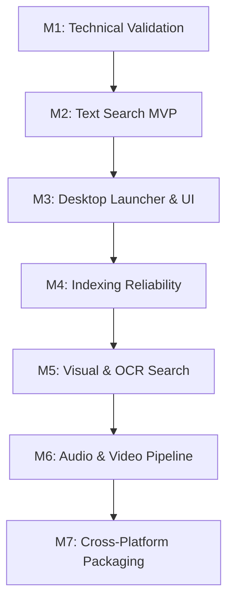

# Product Requirements Document (PRD)

# Search by Memory

**Version:** 2.0  
**Date:** October 12, 2026  
**Status:** Approved / Technical Design Specification  
**Primary Target Platform:** Windows 10/11 (64-bit)  
**Long-term Target Platforms:** Linux, macOS (Cross-platform Core Architecture)  

---

## Product Vision

> *"Find what you remember, not what you named."*

---

## 1. Product Overview

**Search by Memory** is a fast, local-first desktop search application that empowers users to find local files using natural language descriptions and semantic similarity. Users are freed from remembering exact filenames, nested directory paths, or strict keywords. Instead, they can query using vague recollections, conceptual descriptions, or partial context about the file's content.

### Representative User Queries:
* *"The document explaining RAG architecture and retrieval evaluation metrics."*
* *"Screenshot of the database connection error diagram I saved a while ago."*
* *"Auth service code implementation that handles JWT refresh tokens."*
* *"Video tutorial explaining attention mechanisms: query, key, and value."*
* *"PDF research paper about embedding models that I read a few months ago."*

The application indexes local files incrementally in the background, generates high-dimensional embeddings using **Google EmbeddingGemma 2**, and surfaces the most relevant results via vector similarity search.

Built as an instant, keyboard-first desktop launcher (accessible via a global shortcut), it provides relevant snippets, visual previews, page/timestamp references, and one-click actions to open files or reveal their locations in the system file manager.

### Core Product Principles:
1. **Local-first & Privacy by Default**: No documents, embeddings, or queries leave the user's device. Complete offline capability after initial setup.
2. **Semantic-first**: Retrieval is powered by content meaning and context rather than exact keyword or file name matching.
3. **Fast by Design**: Indexing runs asynchronously in the background so queries execute near-instantaneously against pre-computed indices.
4. **Cross-platform by Architecture**: The application core, database schemas, and data pipelines are strictly decoupled from OS-specific APIs.
5. **Extensible & Modular**: Extractor backends, embedding models, vector stores, and modality pipelines adhere to clean provider contracts.
6. **No Generative LLM Required**: Core search does not rely on generative LLMs or chatbot summaries, avoiding hallucinations, unpredictable latency, and excessive resource consumption.

---

## 2. Problem Statement & User Pain Points

Users accumulate tens of thousands of heterogeneous files (documents, source code, screenshots, diagrams, audio recordings, video lectures) scattered across drives and complex folder trees.

Conventional file search tools (like Windows Search or standard file managers) suffer from key limitations:
1. **Name & Path Dependency**: Users frequently forget exact filenames or storage paths.
2. **Vocabulary Mismatch**: The keywords remembered by the user differ from the exact wording inside the file.
3. **Multimodal Blindness**: Image screenshots, diagrams, video segments, and audio files cannot be discovered by content without semantic feature extraction.
4. **Search Friction**: Digging through folder trees or waiting for unindexed disk scans disrupts user workflow.
5. **Stale Indices**: Outdated or inconsistent indices lead to missing files or broken references.

### Target User Personas:

| Persona | Primary Needs & Use Cases |
| :--- | :--- |
| **Software Engineers** | Finding past implementations, configuration snippets, architectural notes, and test suites across legacy repositories. |
| **Researchers & Students** | Locating academic papers, lecture notes, textbook chapters, and recorded seminar timestamps. |
| **Knowledge Workers** | Retrieving meeting decks, slide screenshots, project reports, and client notes across disconnected folders. |
| **Digital Archivists** | Navigating and exploring expansive local file archives containing mixed media. |

---

## 3. Product Goals and Non-Goals

### 3.1 Primary Goals
* Enable file retrieval via natural language descriptions and semantic similarity.
* Deliver sub-second query latency on large local storage volumes (targeting typical user drives of 1 TB+).
* Operate fully offline without cloud dependencies or telemetry transmitting user data.
* Provide a keyboard-driven desktop launcher experience (low latency, minimal workflow disruption).
* Support incremental, background indexing with resilient recovery, pause/resume, and checkpointing.
* Architect a clean abstraction layer enabling expansion from documents and code to images, OCR, audio, and video across Windows, Linux, and macOS.

### 3.2 Non-Goals
* **No Generative Chatbot**: The app will not act as a conversational assistant or generate multi-document synthesis text.
* **No File Mutation**: The app will not edit, move, organize, or delete user files automatically.
* **No OS Search Replacement**: Not intended to hijack system shortcuts (such as the standalone Windows key) or replace low-level OS utilities.
* **No Cloud Sync/Backup**: No syncing of index data or files to third-party cloud infrastructure.
* **No Universal Ingestion on Day 1**: Not every arbitrary binary or multimedia format will be parsed without a dedicated and validated extractor.

---

## 4. System Architecture & Tech Stack

Following the **Modular 5-Layer Architecture** established in PRD 2.0, the core business logic remains independent of the presentation and operating system layers.

```
┌────────────────────────────────────────────────────────┐
│                   Presentation Layer                   │
│         React + TypeScript + Tailwind (UI Shell)       │
└───────────────────────────▲────────────────────────────┘
                            │ Tauri IPC / Events
┌───────────────────────────▼────────────────────────────┐
│                    Application Core                    │
│      Rust (Query Orchestration, Index Scheduler,       │
│           Concurrency Control, Cache Manager)          │
└───────────────┬────────────────────────▲───────────────┘
                │                        │
┌───────────────▼──────────────┐ ┌───────┴───────────────┐
│      Platform Adapters       │ │  Provider Interfaces  │
│  - Global Shortcuts          │ │  - EmbeddingProvider  │
│  - System File Watcher       │ │  - VectorStore        │
│  - File Launch & Reveal      │ │  - ContentExtractor   │
│  - Power/Resource Watcher    │ │  - MediaProcessor     │
└──────────────────────────────┘ └───────┬───────────────┘
                                         │
┌────────────────────────────────────────▼───────────────┐
│                     Storage Layer                      │
│      SQLite (Metadata, Chunks, Job Queue, Status)      │
│      FAISS (High-Performance Vector Index)             │
│      Local Preview/Thumbnail Cache                     │
└────────────────────────────────────────────────────────┘
```

### 4.1 Component Stack

| Component | Initial Technology | Responsibility |
| :--- | :--- | :--- |
| **Desktop Shell** | **Tauri 2** | Window lifecycle, desktop system tray, secure IPC, native packaging. |
| **Frontend UI** | **React + TypeScript** | Launcher UI, keyboard navigation, search results, settings, indexing dashboard. |
| **Application Core** | **Rust** | Search orchestration, file scheduling, concurrency control, SQLite interaction, memory bounds. |
| **Embedding Backend** | **Python + EmbeddingGemma 2** | High-dimensional semantic embedding generation for text, queries, and multimodal inputs. Initial IPC via versioned local IPC/subprocess, with upgrade path to ONNX Runtime / native bindings. |
| **Vector Search Engine**| **FAISS** (via `VectorStore` interface) | Sub-second nearest-neighbor search across indexed vector chunks. |
| **Relational Metadata** | **SQLite** | File tracking, file hashes, document chunks, indexing jobs, exclusions, and configuration. |
| **File Extraction** | Modular Extractors (native/Rust or Python) | Extraction of raw text from PDF, DOCX, Markdown, plain text, and source code. |
| **OCR & Vision** | Tesseract / Local Vision Pipeline | Extracting text from screenshots and image embeddings (P1). |
| **Audio/Video** | Local Whisper & FFmpeg | Audio transcription and keyframe extraction (P2). |

### 4.2 Architectural Layers
1. **Presentation Layer**: Thin, reactive UI handling user input, keyboard events, virtualized result rendering, and indexing telemetry.
2. **Application Core**: Pure domain logic orchestrating retrieval ranking, document chunking pipelines, job queues, and background concurrency limits.
3. **Platform Adapters**: OS-specific implementations for global hotkeys, file monitoring (`ReadDirectoryChangesW` / `inotify` / `FSEvents`), default file opening, and permission resolution.
4. **Provider Interfaces**: Decoupled trait/interface boundaries for `EmbeddingProvider`, `VectorStore`, `ContentExtractor`, and `FileWatcher`.
5. **Storage Layer**: SQLite transactional database for metadata alongside serialized FAISS index files and on-disk thumbnail caches.

---

## 5. Scope & Phased Implementation

### P0 — Minimum Viable Product (Core Semantic Text Search)
* **Desktop Launcher Window**: Centered, distraction-free search bar summonable via configurable global shortcut.
* **Semantic Document Search**: Full content extraction and indexing for:
  * PDF (`.pdf`)
  * Word Documents (`.docx`)
  * Plain Text (`.txt`)
  * Markdown (`.md`, `.markdown`)
  * Source Code (`.rs`, `.py`, `.js`, `.ts`, `.go`, `.cpp`, `.c`, `.java`, `.json`, `.yaml`, `.toml`, etc.)
* **Embedding Model**: Google EmbeddingGemma 2 running locally.
* **Vector Store**: FAISS with persistent on-disk index and ID mapping.
* **Metadata & State Storage**: SQLite handling file catalog, chunk maps, modification hashes, and index statuses.
* **Result Presentation**: Filename, formatted path, relevance snippet, page number / line reference, and file icon.
* **Direct Actions**: Instant launch of file with default application or reveal in system file explorer.
* **Target Directory Selection**: Configurable include/exclude folders and file extensions.
* **Background Incremental Indexing**: Resilient job queue that detects new, modified, or deleted files without re-indexing unchanged data.
* **Crash Recovery & Resume**: Resumption of interrupted indexing jobs upon restart.
* **100% Offline Capability**: Runs entirely disconnected once initial dependencies and model weights are downloaded.

### P1 — Visual & Screenshot Search
* **Text-to-Image Search**: Finding images/diagrams via natural language descriptions matching image embeddings.
* **Local OCR Pipeline**: OCR processing for screenshots and infographics (Tesseract or optimized local OCR) stored as searchable text chunks.
* **Image Thumbnails**: High-performance local thumbnail caching and rendering in the launcher.
* **Metadata Filters**: Quick filtering by file type, parent folder, file size, and modification date.
* **Incremental Visual Indexing**: Efficient diffing of image modifications and deletions.

### P2 — Audio & Video Semantic Search
* **Local Audio Transcription**: Audio segment transcription via local Whisper models.
* **Video Audio Extraction**: Automated audio track extraction from common video containers (`.mp4`, `.mkv`, `.mov`) via FFmpeg.
* **Timestamp Jumping**: Search results link directly to exact media timestamps and launch in media players supporting timestamp parameters.
* **Keyframe Visual Indexing**: Sampling video keyframes for visual scene retrieval.
* **Strict Resource Throttling**: Media indexing throttled or scheduled during system idle to avoid performance degradation.

### P3 — Advanced Retrieval & Refinement
* **Hybrid Retrieval**: Combining dense semantic vectors with lexical BM25 search for precise code and keyword lookup.
* **Cross-Modal Result Blending**: Balanced ranking between text, OCR, image, and transcript matches.
* **Non-Generative Reranking**: Lightweight cross-encoder or reciprocal rank fusion (RRF) without generative LLM overhead.
* **Local Query History**: Optional, privacy-preserving recent query suggestions with one-click clear.
* **Hardware-Specific Optimizations**: Auto-selection between CPU AVX-512, CUDA, and Apple Silicon Metal acceleration.

---

## 6. Functional Requirements (FR) & Acceptance Criteria

### FR-01: Search Launcher & UX
* **Description**: A lightweight, overlay search window accessible globally from any active application.
* **Specifications**:
  * Default shortcut: `Alt + Space` (configurable; conflict detection enabled; must not hijack standalone Windows key).
  * Opens within $\le 300\text{ ms}$ from warm background state.
  * Auto-focuses query input immediately upon opening.
  * Navigable entirely via keyboard:
    * `Arrow Up` / `Arrow Down`: Move selection through results.
    * `Enter`: Open selected file with system default handler.
    * `Ctrl + Enter` (or `Shift + Enter`): Open enclosing directory in File Explorer.
    * `Ctrl + C`: Copy file path to clipboard.
    * `Escape`: Dismiss launcher window without interrupting background indexing.
* **Acceptance Criteria**:
  * [x] Launcher appears instantly on global hotkey trigger.
  * [x] Selecting a result opens the target file in the correct default application.
  * [x] Enclosing folder can be revealed in File Explorer without launching the file.
  * [x] Dismissing the launcher retains background indexing processes seamlessly.

### FR-02: Semantic Query Encoding & Retrieval
* **Description**: Converts the user's natural language input into a dense semantic vector and executes top-K nearest-neighbor search.
* **Specifications**:
  * Supports multilingual queries (tested primarily for English and Indonesian).
  * Adheres strictly to the official EmbeddingGemma 2 prompt/task formatting guidelines.
  * Vector similarity search executed via the `VectorStore` abstraction (backed by FAISS).
  * Returns configurable top-$K$ candidates (default: top 20, deduplicated per parent file).
  * Raw cosine/L2 distance scores normalized as ranking indicators rather than probability truth values.
* **Acceptance Criteria**:
  * [x] User query generates an embedding locally without network activity.
  * [x] Retrieval returns relevant candidates across varied terminology (synonyms, conceptual descriptions).
  * [x] Multiple chunks from the same document are aggregated/deduplicated to prevent single-document result flooding.

### FR-03: Content Ingestion, Extraction & Chunking
* **Description**: Discovers files in included directories, parses content, and splits long documents into coherent search chunks.
* **Specifications**:
  * Initial parser support for `.pdf`, `.docx`, `.txt`, `.md`, and programming language sources.
  * Chunking strategy: Dynamic sliding window (e.g., 256–512 tokens with 10–20% overlap) retaining page/line references.
  * Robust error handling: Unreadable, encrypted, or corrupted files must be logged and bypassed without halting indexing.
  * Ignores binary executables, temporary lock files (`~$*.docx`), and excluded system folders (`$Recycle.Bin`, `node_modules`, `.git`, etc.).
* **Acceptance Criteria**:
  * [x] Parsing failure on an encrypted or corrupt document logs an error and continues with the queue.
  * [x] Original user files are strictly treated as read-only and never modified.
  * [x] Extracted chunks retain accurate page numbers or line ranges for result previews.

### FR-04: Incremental Indexing & Job Resiliency
* **Description**: Continuously tracks directory changes, updating the vector index and metadata store efficiently.
* **Specifications**:
  * File change detection via OS filesystem watchers paired with periodic reconciliation scans.
  * File tracking based on file path, size, modification timestamp (`mtime`), and fast hash checking (e.g., BLAKE3/xxHash) on modified headers.
  * Atomic index updates: Modifying a file deletes its obsolete chunk vectors and inserts new ones.
  * Deleting a file cascades removal of all associated chunks from SQLite and marks vector IDs as deleted.
  * Job queue checkpoints progress so interrupted indexing resumes from the last completed file.
* **Acceptance Criteria**:
  * [x] Modifying a file updates its semantic index without initiating a full directory re-index.
  * [x] Deleted files are purged from search results immediately or upon next queue reconciliation.
  * [x] Sudden app shutdown or crash does not corrupt SQLite or FAISS indices; pending jobs resume on next startup.

### FR-05: Storage, Reconciliation & Migrations
* **Description**: Coordinates transactional relational metadata with serialized vector indices.
* **Specifications**:
  * **SQLite Database**:
    * Stores `files` (id, path, size, mtime, hash, status, error_message).
    * Stores `chunks` (id, file_id, chunk_index, page_number, line_start, line_end, text_snippet, vector_id).
    * Stores `index_jobs` (id, file_id, job_type, status, retry_count, created_at).
    * Schema versioning managed via automated database migrations.
  * **Vector Store**:
    * Maintains vector-to-chunk ID bidirectional mapping.
    * Periodic index compaction and serialization to disk.
    * Self-healing reconciliation: If vector index and SQLite fall out of sync, SQLite serves as the source of truth for rebuilding vector index mappings.
* **Acceptance Criteria**:
  * [x] SQLite schema migrations apply automatically across application upgrades.
  * [x] Database and vector store remain consistent across insertions and deletions.
  * [x] Rebuilding vector index is possible from existing extracted chunk data without reparsing raw source files.

### FR-06: Privacy, Offline Integrity & Exclusions
* **Description**: Guarantees zero external data leakage and provides full exclusion controls to the user.
* **Specifications**:
  * Zero remote telemetry containing file names, paths, queries, or extracted content.
  * Explicit exclusion rules: Folders (glob patterns), file extensions, and file size thresholds (e.g., skip text files $>50\text{ MB}$).
  * "Clear All Data" action: One-click option to completely purge local SQLite databases, vector indices, and cached thumbnails.
* **Acceptance Criteria**:
  * [x] Application functions completely in an air-gapped environment with network adapters disabled.
  * [x] Excluded directories and file patterns are never opened, parsed, or embedded.
  * [x] Purge action thoroughly erases all index artifacts from disk.

### FR-07: Cross-Platform Abstraction
* **Description**: Application core and data models remain platform-agnostic, with all OS-specific facilities delegated to platform adapters.
* **Specifications**:
  * All paths stored internally in normalized format (forward-slash UTF-8 or platform-neutral abstractions).
  * Adapters implement distinct implementations for Windows (`windows-sys`/Win32), Linux (`X11`/`Wayland`, `inotify`), and macOS (`Cocoa`, `FSEvents`).
* **Acceptance Criteria**:
  * [x] Core Rust logic compiles and executes unit tests on Windows, Linux, and macOS environments without OS-specific `#cfg` branches in business logic.

### FR-08: Observability & Status Dashboard
* **Description**: Transparent status reporting for background indexing activities and resource utilization.
* **Specifications**:
  * Dashboard displays: total files indexed, pending jobs, failed files, index size on disk, and model status.
  * Search results report retrieval latency (e.g., *"Found 12 matches in 42 ms"*).
  * Actionable error log allowing users to review why specific files failed extraction (e.g., password-protected PDF).

---

## 7. Non-Functional Requirements & Engineering Baselines

### 7.1 Performance Benchmarks
* **Launcher Render Time**: $\le 300\text{ ms}$ (warm process in system tray).
* **Search Query Latency**: $P95 \le 1.0\text{ second}$ for text queries on an indexed collection of 500,000 vectors.
* **Idle System Footprint**: $\le 1\text{–}2\%\text{ CPU}$ usage and minimal RAM when no active indexing is occurring.
* **Indexing Throughput**: Background extraction and embedding dynamically throttled to prevent UI stutter or excessive battery drain.

### 7.2 Hardware Baseline & Storage Planning
* **Development Target Baseline**:
  * OS: Windows 10/11 64-bit
  * CPU: 6-core / 12-thread modern x86_64 CPU
  * RAM: 16 GB DDR4/DDR5
  * GPU: NVIDIA GeForce RTX 4060 (8 GB VRAM) for accelerated inference, with CPU fallback.
* **Vector Storage Footprint Estimation** (based on EmbeddingGemma 2 with 256-dimension float32 embeddings):
  * **Raw Vector Size**: $256 \times 4\text{ bytes} = 1{,}024\text{ bytes per vector} \approx 1\text{ KB}$.
  * **100,000 Vectors**: $\approx 102\text{ MB}$ raw vectors ($+ \approx 50\text{ MB}$ SQLite metadata).
  * **500,000 Vectors**: $\approx 512\text{ MB}$ raw vectors ($+ \approx 250\text{ MB}$ SQLite metadata).
  * **1,000,000 Vectors**: $\approx 1.02\text{ GB}$ raw vectors ($+ \approx 500\text{ MB}$ SQLite metadata).
  *(A typical 1 TB drive containing ~10,000 user documents typically yields 100,000–300,000 chunks, requiring $<500\text{ MB}$ total index storage).*

---

## 8. UX & Keyboard-First Interaction Design

The launcher UI follows the minimalist aesthetic of modern search launchers (e.g., Spotlight, Raycast, PowerToys Run).

### UI Layout
```
┌─────────────────────────────────────────────────────────────┐
│ 🔍  Type what you remember about the file...          [ Esc]│
├─────────────────────────────────────────────────────────────┤
│ 📄 Quarterly Financial Report Q3.docx         (Page 14) 89% │
│    "...net profit increased by 18% following the launch..." │
│    D:\Work\Finances\2026\Q3_Report.docx                     │
├─────────────────────────────────────────────────────────────┤
│ 🦀 auth_service.rs                             (Line 142)84% │
│    "pub async fn refresh_jwt_token(token: &str) -> Result"  │
│    D:\Projects\backend\src\auth_service.rs                  │
├─────────────────────────────────────────────────────────────┤
│ 🖼️ database_architecture_diagram.png                     78% │
│    [Thumbnail Preview] Primary-Replica failover cluster     │
│    D:\Notes\Architecture\database_diagram.png               │
├─────────────────────────────────────────────────────────────┤
│ [↵ Open]   [Ctrl+↵ Reveal Folder]   [Ctrl+C Copy Path]  24ms│
└─────────────────────────────────────────────────────────────┘
```

### UX Design Rules:
1. **Zero Layout Shifts**: Results render in stable slots with virtual scrolling.
2. **True Explanations Only**: Match snippets must be verbatim extracts from the chunk or metadata; the system never invents or hallucinates justifications.
3. **Missing Source Indication**: If a file was deleted externally while still in index, the item is visibly flagged as *"File missing from disk"* and offers an option to purge it.

---

## 9. Evaluation Plan & Quality Metrics

Retrieval quality is the primary product metric. A local evaluation suite of **50–100 benchmark queries** (spanning both English and Indonesian) will be maintained with ground-truth labeled targets.

### Evaluation Metrics:
* **Recall@5 & Recall@10**: Proportion of test queries where the intended target appears in the top 5 / 10 results.
* **Mean Reciprocal Rank (MRR)**: Evaluates the ranking position of the first relevant result.
* **nDCG@10**: Evaluates multi-candidate ranking quality.
* **P50 & P95 Search Latency**: Evaluates query responsiveness.
* **Extraction Failure Rate**: Percentage of encountered files that fail ingestion.

### Comparison Baselines:
1. Standard filename match (baseline zero-point).
2. Lexical keyword / BM25 search.
3. EmbeddingGemma 2 across candidate dimension configurations (e.g., 256 vs 512 vs 768).

---

## 10. Phased Implementation Milestones



* **Milestone 1 — Technical Validation**:
  * Validate EmbeddingGemma 2 local inference and prompt formatting.
  * Benchmark embedding generation latency on CPU vs GPU.
  * Validate FAISS vector index insertion, search, and SQLite mapping.
  * Finalize Rust ↔ Python IPC communication protocol.
* **Milestone 2 — Text Search MVP**:
  * Implement extractors for PDF, DOCX, TXT, Markdown, and code.
  * Implement sliding-window chunking.
  * End-to-end command-line retrieval verification.
* **Milestone 3 — Desktop Launcher UI**:
  * Build Tauri 2 + React + TypeScript launcher.
  * Implement global hotkey registration, keyboard navigation, and file launch actions.
* **Milestone 4 — Indexing Reliability & Monitoring**:
  * Implement filesystem watcher with incremental update handling.
  * Implement job queue pause, resume, and checkpoint recovery.
  * Exclusions manager and settings dashboard.
* **Milestone 5 — Visual Search (P1)**:
  * Local OCR integration for screenshots and image embedding pipeline.
  * Image thumbnail generation and launcher preview cards.
* **Milestone 6 — Audio & Video Search (P2)**:
  * Local Whisper integration for audio and extracted video soundtracks.
  * Timestamp jumping support.
* **Milestone 7 — Cross-Platform Expansion**:
  * Implement Linux and macOS platform adapters.
  * Validate packaging across `.msi`/`.exe`, `.AppImage`/`.deb`, and `.dmg`.

---

## 11. Open Technical Decisions (To be resolved in Technical Spec)

1. **Rust ↔ Python IPC Mechanism**: Selection between local gRPC over Unix Domain Sockets / Named Pipes vs JSON-RPC / lightweight shared memory vs direct C-ABI binding.
2. **FAISS Index Configuration**: Evaluation of flat inner-product (`IndexFlatIP`) vs quantized/HNSW indices (`IndexHNSWFlat`) based on memory bounds.
3. **Default Embedding Dimension**: Validation whether 256-dimension truncation preserves sufficient semantic fidelity compared to full dimension.
4. **Embedding Runtime Migration**: Feasibility of migrating from Python PyTorch to ONNX Runtime / `ort` in Rust for unified single-binary distribution.
5. **Concurrency & Resource Throttling Rules**: Exact CPU thread allocation and pause-on-battery logic for laptops.

---

## 12. Definition of Done (DoD) for MVP

The MVP release is considered complete and production-ready when:
* [ ] Application installs and launches cleanly on Windows 10/11 (64-bit).
* [ ] User can configure directories to index via settings.
* [ ] Core document formats (PDF, DOCX, TXT, MD, source code) are reliably parsed and embedded.
* [ ] Search launcher opens in ≤ 300 ms via global hotkey (`Alt + Space`).
* [ ] Natural language semantic queries return relevant files with preview snippets and page references in ≤ 1.0 second.
* [ ] User can immediately open the target file or reveal its enclosing folder using keyboard shortcuts.
* [ ] Background indexing detects file modifications and deletions incrementally.
* [ ] Indexing resumes automatically after application restart without data corruption.
* [ ] Application functions 100% offline with zero outbound network calls.
* [ ] Core retrieval logic has zero dependency on generative LLM services.
* [ ] Clean provider abstraction interfaces exist for vector store, embeddings, and platform adapters.
